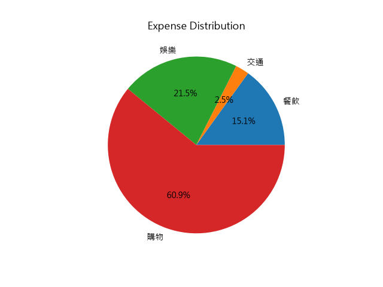

# expense-tracker
Expense tracking tool - SE Assignment 1
## 輸入模組（add_expense.py）

### 環境需求
- Python 3.8 以上
- 不需要安裝額外套件（只使用 Python 內建函式庫）

### 執行方式
    python add_expense.py

### 使用流程
1. 輸入日期（格式 YYYY-MM-DD，直接按 Enter 會使用今天）
2. 輸入金額（必須大於 0）
3. 輸入類別（例如：餐飲、交通、娛樂，留空則為「其他」）
4. 輸入備註（可留空）
5. 輸入 y 繼續新增，輸入 n 結束

### 資料儲存格式
資料會存在 `expenses.csv`，欄位如下：

    date,amount,category,note
    2026-11-10,120.0,餐飲,午餐便當


## Member B－支出圓餅圖視覺化功能

### 功能說明
- 使用 plot_pie.py 讀取 expenses.csv。
- 依照支出類別統計總金額。
- 自動計算各類別的支出百分比。
- 支援中文類別顯示。
- 產生圓餅圖並儲存為 pie_chart.png。

### 執行方式

```bash
python plot_pie.py
```

### 圓餅圖範例

